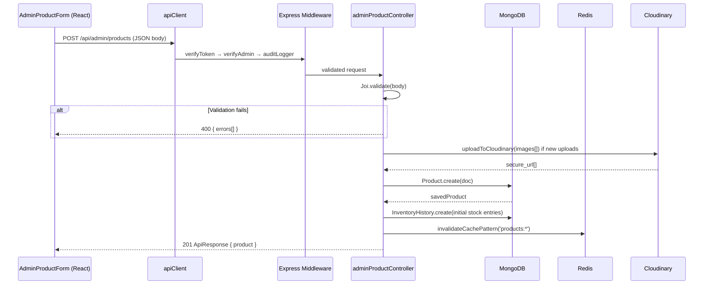
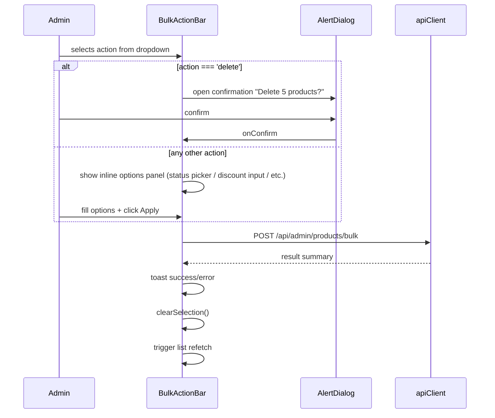

# Design Document: Admin Product Management

## Overview

The Admin Product Management feature replaces the existing flat inline form in `AdminProducts.tsx` with a production-quality, Shopify-inspired product management system for the Matasree Store. It extends the MongoDB `Product` model, introduces an `InventoryHistory` collection, adds dedicated admin API routes under `/api/admin/products`, and rebuilds the frontend as a split list page / multi-section accordion form.

The system must remain fully backward-compatible with the existing storefront, cart, order, and wishlist subsystems. All new fields are added with schema defaults so that existing Mongoose documents continue to read without errors. The top-level `price`, `stock`, `image`, and `variants` fields are preserved exactly as-is; new richer fields (SEO, shipping, attributes, relatedProducts, etc.) are additive.

This design follows the patterns already established in the codebase: Joi validation in controllers, `ApiResponse` utility for all responses, `invalidateCachePattern('products:*')` on every write, `verifyToken + verifyAdmin` middleware on all admin writes, `cron` for background jobs (matching `cartAbandonmentJob`), `multer` → `imageOptimizer` → `uploadToCloudinary` pipeline for images, and `shadcn/ui` components with Tailwind CSS on the frontend.

---

## Architecture

### System Architecture Overview

```mermaid
graph TD
    subgraph Frontend["Frontend (React + TypeScript + Tailwind)"]
        APL[AdminProductList page]
        APF[AdminProductForm page]
        IMG[ImageGallery component]
        VAR[VariantEditor component]
        SEO[SeoPreview component]
        BULK[BulkActionBar component]
        IMP[ImportExportPanel component]
        ST[productAdminStore - Zustand]
        API2[apiClient extensions]
    end

    subgraph Backend["Backend (Node.js + Express + TypeScript)"]
        AR[/api/admin/products routes]
        APC[adminProductController]
        PC[productController - updated]
        JOB[scheduledPublishJob - cron]
        VAL[Joi validation schemas]
        CACHE[Redis cache middleware]
        CLOUD[Cloudinary / local fallback]
        AU[auditLogger middleware]
    end

    subgraph DB["MongoDB"]
        PROD[(Product collection)]
        INVH[(InventoryHistory collection)]
        CAT[(Category collection)]
    end

    APL --> API2
    APF --> API2
    IMG --> API2
    BULK --> API2
    IMP --> API2
    API2 -->|JWT + CSRF| AR
    AR --> APC
    AR --> CACHE
    APC --> VAL
    APC --> PROD
    APC --> INVH
    APC --> CAT
    APC --> CLOUD
    APC --> AU
    JOB -->|every 1 min| PROD
    APL --> ST
    APF --> ST
```

### Request / Response Flow for Product Create



---

## Data Models

### Mongoose Schema Additions (backward-compatible)

The existing `IProductVariant` interface and `productVariantSchema` are **replaced** with a richer extended variant. All new top-level fields are optional with defaults so existing documents load cleanly.

```typescript
// models/Product.ts — extended interfaces

export interface IProductVariantExtended {
  // Legacy fields preserved (storefront compat)
  weight: string;
  price: number;           // maps to sellingPrice for compat
  originalPrice?: number;  // maps to mrp for compat
  stock: number;

  // New fields
  sku: string;
  barcode?: string;
  mrp: number;
  sellingPrice: number;
  discountPercent: number;
  discountAmount: number;
  reservedStock: number;
  lowStockThreshold: number;
  isAvailable: boolean;
  variantImage?: string;
}

export interface IProductSeo {
  seoTitle?: string;
  seoDescription?: string;
  metaKeywords?: string[];
  canonicalUrl?: string;
  ogImage?: string;
}

export interface IProductShipping {
  weightGrams?: number;
  lengthCm?: number;
  widthCm?: number;
  heightCm?: number;
  hsnCode?: string;
  gstPercent?: number;
  countryOfOrigin?: string;
  shippingClass?: 'Standard' | 'Express' | 'Heavy';
}

export interface IProductAttribute {
  key: string;
  value: string;
}

export interface IRelatedProduct {
  productId: mongoose.Types.ObjectId;
  relationType: 'frequently_bought' | 'recommended' | 'cross_sell' | 'upsell';
}

export type ProductStatus =
  | 'active' | 'inactive' | 'draft' | 'scheduled' | 'hidden' | 'archived';
```

### New Fields Added to productSchema

```typescript
// All new fields are optional with defaults — existing docs read cleanly

slug:               { type: String, unique: true, sparse: true }
brand:              { type: String, default: '' }
subcategory:        { type: String, default: '' }
shortDescription:   { type: String, maxlength: 300, default: '' }
fullDescription:    { type: String, default: '' }
status:             { type: String, enum: ['active','inactive','draft','scheduled','hidden','archived'], default: 'active' }
scheduledPublishAt: { type: Date, default: null }
isFeatured:         { type: Boolean, default: false }
isNewArrival:       { type: Boolean, default: false }
featuredImage:      { type: String, default: '' }
searchKeywords:     { type: [String], default: [] }
seo:                { type: productSeoSchema, default: () => ({}) }
shipping:           { type: productShippingSchema, default: () => ({}) }
attributes:         { type: [productAttributeSchema], default: [] }
relatedProducts:    { type: [relatedProductSchema], default: [] }
```

### Slug Auto-generation (pre-save hook)

```typescript
productSchema.pre('save', async function (next) {
  if (!this.isModified('name') && this.slug) return next();
  const base = this.name.toLowerCase().replace(/[^a-z0-9]+/g, '-').replace(/^-|-$/g, '');
  let slug = base;
  let suffix = 1;
  while (await mongoose.model('Product').exists({ slug, _id: { $ne: this._id } })) {
    slug = `${base}-${suffix++}`;
  }
  this.slug = slug;
  next();
});
```

### New Indexes

```typescript
productSchema.index({ slug: 1 }, { unique: true, sparse: true });
productSchema.index({ brand: 1 });
productSchema.index({ status: 1 });
productSchema.index({ isFeatured: 1 });
productSchema.index({ isNewArrival: 1 });
productSchema.index({ price: 1 });
productSchema.index({ createdAt: -1 });
productSchema.index({ sold: -1 });
// Existing indexes preserved:
productSchema.index({ name: 'text', description: 'text', tags: 'text' });
productSchema.index({ category: 1, price: 1 });
productSchema.index({ isBestseller: 1, createdAt: -1 });
```

---

## InventoryHistory Collection

A new `InventoryHistory` collection records every stock change per variant, providing a full audit trail.

```typescript
// models/InventoryHistory.ts

export interface IInventoryHistory {
  productId:     mongoose.Types.ObjectId;   // ref: 'Product'
  variantId:     mongoose.Types.ObjectId;   // embedded variant _id
  variantWeight: string;                    // denormalised for readability
  deltaQuantity: number;                    // positive = add, negative = remove
  previousStock: number;
  newStock:      number;
  reason:        string;                    // 'admin_adjustment' | 'order_placed' | 'order_cancelled' | 'import' | 'initial'
  performedBy:   mongoose.Types.ObjectId;   // ref: 'User' (admin userId)
  note?:         string;
  createdAt:     Date;
}

const inventoryHistorySchema = new Schema<IInventoryHistory>(
  {
    productId:     { type: Schema.Types.ObjectId, ref: 'Product', required: true, index: true },
    variantId:     { type: Schema.Types.ObjectId, required: true },
    variantWeight: { type: String, required: true },
    deltaQuantity: { type: Number, required: true },
    previousStock: { type: Number, required: true },
    newStock:      { type: Number, required: true },
    reason:        { type: String, required: true },
    performedBy:   { type: Schema.Types.ObjectId, ref: 'User', required: true },
    note:          { type: String },
  },
  { timestamps: true }
);

inventoryHistorySchema.index({ productId: 1, createdAt: -1 });
```

---

## Backend API Endpoints

All admin write endpoints use the middleware chain:
`verifyToken → verifyAdmin → auditLogAction(event, 'Product') → invalidateProductsCache`

### New Admin Product Routes (`/api/admin/products`)

| Method | Path | Description |
|--------|------|-------------|
| GET | `/api/admin/products` | Paginated list with filters (page, limit, sort, search, category, brand, status, inStock, isFeatured, dateFrom, dateTo) |
| GET | `/api/admin/products/:id` | Full product document with populated category and relatedProducts |
| POST | `/api/admin/products` | Create product (full extended schema) |
| PUT | `/api/admin/products/:id` | Update product (full extended schema) |
| DELETE | `/api/admin/products/:id` | Hard delete (with confirmation guard on frontend) |
| PATCH | `/api/admin/products/:id/status` | Update only `status` field |
| POST | `/api/admin/products/:id/duplicate` | Copy product → "Copy of …", new slug, `draft` status |
| GET | `/api/admin/products/:id/inventory` | Per-variant stock summary + last-updated timestamp |
| PUT | `/api/admin/products/:id/variants/:variantId/stock` | Adjust variant stock, record InventoryHistory |
| GET | `/api/admin/products/:id/inventory/history` | Paginated InventoryHistory for product |
| POST | `/api/admin/products/bulk` | Bulk operation (delete / status / category / discount / price / inventory) |
| GET | `/api/admin/products/export` | CSV download of all products + variants |
| POST | `/api/admin/products/import` | CSV/Excel upload → create or update products |
| GET | `/api/admin/products/search-picker` | Lightweight search (name, id, image) for related-products picker |

### Route Registration in adminRoutes.ts

New product routes are registered **before** the existing `router.use(verifyToken, verifyAdmin)` guard (so the guard applies to all of them). They live alongside the existing analytics/banner/recipe routes.

```typescript
// New block inside adminRoutes.ts
import * as adminProductController from '../controllers/adminProductController';
import upload from '../middleware/upload';

const invalidateProductsCache = (req: any, res: any, next: any) => {
  res.on('finish', async () => {
    if (res.statusCode >= 200 && res.statusCode < 300) {
      await invalidateCachePattern('products:*');
    }
  });
  next();
};

// All admin product routes (verifyToken + verifyAdmin applied via router.use above)
router.get('/products',                       adminProductController.listProducts);
router.get('/products/export',                adminProductController.exportProducts);
router.get('/products/search-picker',         adminProductController.searchPickerProducts);
router.post('/products/import',               upload.single('file'), adminProductController.importProducts);
router.post('/products/bulk',                 invalidateProductsCache, adminProductController.bulkOperation);
router.get('/products/:id',                   adminProductController.getProduct);
router.post('/products',                      invalidateProductsCache, auditLogAction('CREATE_PRODUCT','Product'), adminProductController.createProduct);
router.put('/products/:id',                   invalidateProductsCache, auditLogAction('UPDATE_PRODUCT','Product'), adminProductController.updateProduct);
router.delete('/products/:id',                invalidateProductsCache, auditLogAction('DELETE_PRODUCT','Product'), adminProductController.deleteProduct);
router.patch('/products/:id/status',          invalidateProductsCache, adminProductController.updateProductStatus);
router.post('/products/:id/duplicate',        invalidateProductsCache, adminProductController.duplicateProduct);
router.get('/products/:id/inventory',         adminProductController.getInventory);
router.put('/products/:id/variants/:variantId/stock', invalidateProductsCache, adminProductController.adjustVariantStock);
router.get('/products/:id/inventory/history', adminProductController.getInventoryHistory);
```

---

## Joi Validation Schema Design

A new file `validators/productValidator.ts` holds the full Joi schemas. The existing `productSchema` in `productController.ts` remains unchanged for the legacy public routes.

```typescript
// validators/productValidator.ts

const variantExtendedSchema = Joi.object({
  // Legacy compat fields
  weight:          Joi.string().trim().required(),
  price:           Joi.number().min(0).required(),   // sellingPrice alias
  originalPrice:   Joi.number().min(0).optional(),   // mrp alias
  stock:           Joi.number().min(0).required(),

  // New fields
  sku:             Joi.string().trim().alphanum().max(64).required(),
  barcode:         Joi.string().trim().optional().allow(''),
  mrp:             Joi.number().min(0).required(),
  sellingPrice:    Joi.number().min(0).required(),
  discountPercent: Joi.number().min(0).max(100).required(),
  discountAmount:  Joi.number().min(0).required(),
  reservedStock:   Joi.number().min(0).default(0),
  lowStockThreshold: Joi.number().min(0).default(10),
  isAvailable:     Joi.boolean().default(true),
  variantImage:    Joi.string().uri().optional().allow(''),
}).custom((value, helpers) => {
  if (value.sellingPrice > value.mrp) {
    return helpers.error('variant.sellingPriceExceedsMrp');
  }
  return value;
});

const seoSchema = Joi.object({
  seoTitle:        Joi.string().max(60).optional().allow(''),
  seoDescription:  Joi.string().max(160).optional().allow(''),
  metaKeywords:    Joi.array().items(Joi.string()).default([]),
  canonicalUrl:    Joi.string().uri().optional().allow(''),
  ogImage:         Joi.string().uri().optional().allow(''),
});

const shippingSchema = Joi.object({
  weightGrams:     Joi.number().min(0).optional(),
  lengthCm:        Joi.number().min(0).optional(),
  widthCm:         Joi.number().min(0).optional(),
  heightCm:        Joi.number().min(0).optional(),
  hsnCode:         Joi.string().pattern(/^\d{4,8}$/).optional().allow(''),
  gstPercent:      Joi.valid(0, 5, 12, 18, 28).optional(),
  countryOfOrigin: Joi.string().default('India'),
  shippingClass:   Joi.valid('Standard', 'Express', 'Heavy').optional(),
});

const attributeSchema = Joi.object({
  key:   Joi.string().trim().required(),
  value: Joi.string().trim().required(),
});

const relatedProductSchema = Joi.object({
  productId:    Joi.string().required(),
  relationType: Joi.valid('frequently_bought','recommended','cross_sell','upsell').required(),
});

export const adminProductSchema = Joi.object({
  // Required core
  name:              Joi.string().trim().required(),
  description:       Joi.string().required(),   // fullDescription / legacy
  price:             Joi.number().min(0).required(),
  stock:             Joi.number().min(0).required(),
  image:             Joi.string().required(),
  weight:            Joi.string().trim().required(),
  category:          Joi.string().required(),

  // Optional core
  originalPrice:     Joi.number().min(0).optional(),
  images:            Joi.array().items(Joi.string()).max(10).default([]),
  variants:          Joi.array().items(variantExtendedSchema).default([]),
  tags:              Joi.array().items(Joi.string().trim()).default([]),
  isNewProduct:      Joi.boolean().optional(),
  isBestseller:      Joi.boolean().optional(),

  // New fields
  brand:             Joi.string().trim().default(''),
  subcategory:       Joi.string().trim().default(''),
  shortDescription:  Joi.string().max(300).default(''),
  fullDescription:   Joi.string().default(''),
  status:            Joi.valid('active','inactive','draft','scheduled','hidden','archived').default('active'),
  scheduledPublishAt: Joi.date().greater('now').when('status', { is: 'scheduled', then: Joi.required() }).allow(null),
  isFeatured:        Joi.boolean().default(false),
  isNewArrival:      Joi.boolean().default(false),
  featuredImage:     Joi.string().uri().optional().allow(''),
  searchKeywords:    Joi.array().items(Joi.string().trim()).default([]),
  seo:               seoSchema.default({}),
  shipping:          shippingSchema.default({}),
  attributes:        Joi.array().items(attributeSchema).default([]),
  relatedProducts:   Joi.array().items(relatedProductSchema).default([]),
});

export const bulkOperationSchema = Joi.object({
  productIds: Joi.array().items(Joi.string()).min(1).required(),
  action:     Joi.valid('delete','status','category','discount','price','inventory').required(),
  payload:    Joi.object().required(),
});

export const stockAdjustmentSchema = Joi.object({
  quantity: Joi.number().integer().required(),
  reason:   Joi.string().required(),
  note:     Joi.string().optional().allow(''),
});
```

---

## Components and Interfaces

### Component Tree

```mermaid
graph TD
    APL[AdminProductList\npage route: /admin/products]
    APF[AdminProductForm\npage route: /admin/products/new\n         /admin/products/:id/edit]
    
    APL --> PT[ProductTable]
    APL --> PF[ProductFilters]
    APL --> BAB[BulkActionBar]
    APL --> IEP[ImportExportPanel]
    APL --> SSR[StatusBadge]

    APF --> BI[Accordion: Basic Info\nname, brand, slug, category, subcategory\nshortDescription, fullDescription\nRichTextEditor, flags]
    APF --> VA[Accordion: Variants\nVariantEditor table\ndiscount calculator]
    APF --> IG[Accordion: Images\nImageGallery\ndrag-drop reorder\nfeaturedImage selector]
    APF --> IN[Accordion: Inventory\nper-variant stock\nlow-stock indicators]
    APF --> SK[Accordion: Search Keywords\nTagInput]
    APF --> SE[Accordion: SEO\nSerpPreview\ncharacter counters]
    APF --> SH[Accordion: Shipping\nweightGrams, dims\nhsnCode, gstPercent]
    APF --> AT[Accordion: Attributes\nkey-value rows\nsuggestion list]
    APF --> RP[Accordion: Related Products\nProductPicker search\nrelation type]
    APF --> VIS[Accordion: Visibility\nstatus selector\nscheduledPublishAt picker]
    APF --> SSB[StickyActionBar\nSave / Save as Draft\nCtrl+S shortcut]
```



### Key Component Descriptions

**AdminProductList** (`pages/AdminProductList.tsx`)
- Replaces current `AdminProducts.tsx` list section
- Server-side pagination, sort, and filter via `GET /api/admin/products`
- Renders `ProductTable` with skeleton rows during load (`aria-busy`)
- Hosts `BulkActionBar` that appears when `selectedIds.length > 0`

**AdminProductForm** (`pages/AdminProductForm.tsx`)
- Standalone page for create (`/admin/products/new`) and edit (`/admin/products/:id/edit`)
- Accordion layout using shadcn/ui `Accordion` component
- Autosave to `localStorage` every 60 s via `useEffect` + `setInterval`
- `useBeforeUnload` hook triggers browser confirm on unsaved changes
- Ctrl+S / Cmd+S handled via `useEffect` keydown listener
- Each accordion section is lazily rendered (content only mounted when expanded)

**VariantEditor** (`components/admin/VariantEditor.tsx`)
- Inline-editable table row per variant (shadcn `Table` + controlled inputs)
- Bidirectional discount calculator: changing `discountPercent` recalculates `sellingPrice`; changing `sellingPrice` recalculates `discountPercent`
- Add blank row, duplicate row, remove row (minimum 1 variant guard)
- SKU uniqueness validated client-side on blur; confirmed server-side on submit

**ImageGallery** (`components/admin/ImageGallery.tsx`)
- Uses `@dnd-kit/core` and `@dnd-kit/sortable` for drag-and-drop reordering
- Each image card: thumbnail, alt-text input, "Set as Featured" button, delete button
- Multi-file `<input multiple accept="image/jpeg,image/png,image/webp">` uploads up to 5 files simultaneously, each via sequential `POST /products/upload/image` calls
- Shows per-file upload progress bar (indeterminate spinner)
- Max 10 images enforced client-side; file size ≤ 5 MB, mime type validated before upload

**SerpPreview** (`components/admin/SerpPreview.tsx`)
- Renders a Google SERP snippet preview (title in blue, URL in green, description in grey)
- Accepts `title`, `description`, `slug` as props, updates in real time
- Character count badge: green ≤ limit, red > limit

**BulkActionBar** (`components/admin/BulkActionBar.tsx`)
- Appears as a sticky banner at the bottom when any row is selected
- Action dropdown: Delete, Change Status, Change Category, Apply Discount %, Update Price, Update Inventory, Export Selected
- Delete opens a `AlertDialog` naming the count; cancelling prevents operation

**ImportExportPanel** (`components/admin/ImportExportPanel.tsx`)
- Export: calls `GET /api/admin/products/export`, triggers browser download
- Import: file picker → uploads to `POST /api/admin/products/import` → shows result summary (created N, updated N, failed N with row-level errors)

---

## State Management

### Local Form State vs Zustand

The form data for `AdminProductForm` is held in **local React state** (`useState`), not Zustand. The form is complex (dozens of fields, variant rows, image arrays) and the data only needs to live for the lifetime of the form page. Using local state avoids unnecessary global state pollution and simplifies reset-on-unmount.

**Zustand `productAdminStore`** is used only for:
- `selectedProductIds: string[]` — shared between `ProductTable` and `BulkActionBar`
- `listFilters: ProductListFilters` — persisted across navigations (category, status, page, sort)
- `isImporting: boolean` and `importResult` — result state from the import job

```typescript
// store/productAdminStore.ts
interface ProductAdminState {
  selectedProductIds: string[];
  listFilters: ProductListFilters;
  isImporting: boolean;
  importResult: ImportResult | null;

  setSelectedIds: (ids: string[]) => void;
  toggleSelected: (id: string) => void;
  clearSelection: () => void;
  setListFilters: (f: Partial<ProductListFilters>) => void;
  setImportResult: (r: ImportResult | null) => void;
}
```

### Autosave to localStorage

```typescript
// Inside AdminProductForm

const AUTOSAVE_KEY = `adminProductDraft_${productId ?? 'new'}`;

useEffect(() => {
  if (!isDirty) return;
  const timer = setInterval(() => {
    localStorage.setItem(AUTOSAVE_KEY, JSON.stringify(formValues));
  }, 60_000);
  return () => clearInterval(timer);
}, [isDirty, formValues]);

// On mount: check for a saved draft and offer to restore
useEffect(() => {
  const saved = localStorage.getItem(AUTOSAVE_KEY);
  if (saved) toast('Unsaved draft found', { action: { label: 'Restore', onClick: () => restoreDraft(saved) } });
}, []);
```

### apiClient Extensions

New typed methods are added to the existing `ApiClient` class in `services/api.ts`:

```typescript
// Admin product management
adminListProducts(params: AdminProductListParams) { return this.client.get('/admin/products', { params }); }
adminGetProduct(id: string) { return this.client.get(`/admin/products/${id}`); }
adminCreateProduct(data: any) { return this.client.post('/admin/products', data); }
adminUpdateProduct(id: string, data: any) { return this.client.put(`/admin/products/${id}`, data); }
adminDeleteProduct(id: string) { return this.client.delete(`/admin/products/${id}`); }
adminUpdateProductStatus(id: string, status: string) { return this.client.patch(`/admin/products/${id}/status`, { status }); }
adminDuplicateProduct(id: string) { return this.client.post(`/admin/products/${id}/duplicate`); }
adminBulkOperation(payload: BulkOperationPayload) { return this.client.post('/admin/products/bulk', payload); }
adminExportProducts() { return this.client.get('/admin/products/export', { responseType: 'blob' }); }
adminImportProducts(formData: FormData) { return this.client.post('/admin/products/import', formData, { headers: { 'Content-Type': 'multipart/form-data' } }); }
adminGetInventory(id: string) { return this.client.get(`/admin/products/${id}/inventory`); }
adminAdjustVariantStock(id: string, variantId: string, data: StockAdjustPayload) { return this.client.put(`/admin/products/${id}/variants/${variantId}/stock`, data); }
adminSearchPicker(q: string) { return this.client.get('/admin/products/search-picker', { params: { q } }); }
```

---

## Image Upload Flow

### Upload Pipeline

```mermaid
sequenceDiagram
    participant U as User
    participant IG as ImageGallery
    participant API as apiClient
    participant MW as upload middleware (multer)
    participant OPT as imageOptimizer
    participant CL as Cloudinary

    U->>IG: select up to 5 files
    IG->>IG: validate mime + size (< 5 MB each)
    loop each file
        IG->>IG: show indeterminate progress spinner
        IG->>API: POST /products/upload/image (FormData)
        API->>MW: multer memoryStorage (10 MB limit)
        MW->>OPT: optimizeProductImage (sharp: resize ≤ 1200×1200, convert to WebP)
        OPT->>CL: uploadToCloudinary(buffer, 'matasree/products')
        CL-->>API: { imageUrl: secure_url, publicId }
        API-->>IG: imageUrl
        IG->>IG: replace spinner with thumbnail
        IG->>IG: append to images[] state
    end
    U->>IG: drag to reorder
    IG->>IG: update images[] array order in memory
    U->>IG: click "Set as Featured"
    IG->>IG: move image to index 0, set featuredImage field
```

### Drag-and-Drop Reorder Implementation

`@dnd-kit/sortable` is the chosen library (already used in the project for other interactions). The `ImageGallery` wraps the image list in a `<SortableContext items={imageIds}>` and each `ImageCard` is wrapped in `useSortable`. On drag-end the `images[]` array is reordered using `arrayMove` from `@dnd-kit/sortable`.

```typescript
// Simplified ImageGallery structure
<DndContext onDragEnd={handleDragEnd}>
  <SortableContext items={images.map(img => img.id)} strategy={rectSortingStrategy}>
    {images.map(img => (
      <SortableImageCard
        key={img.id}
        image={img}
        isFeatured={img.url === featuredImage}
        onSetFeatured={() => setFeaturedImage(img.url)}
        onDelete={() => removeImage(img.id)}
        onAltChange={(alt) => updateAlt(img.id, alt)}
      />
    ))}
  </SortableContext>
</DndContext>
```

### File Validation (Client-side, before upload)

```typescript
const MAX_FILE_SIZE = 5 * 1024 * 1024; // 5 MB per req spec
const ALLOWED_TYPES = ['image/jpeg', 'image/png', 'image/webp'];

function validateImageFile(file: File): string | null {
  if (!ALLOWED_TYPES.includes(file.type)) return 'Only JPEG, PNG, and WebP formats are accepted';
  if (file.size > MAX_FILE_SIZE) return `File size must be under 5 MB (got ${(file.size / 1024 / 1024).toFixed(1)} MB)`;
  return null;
}
```

---

## Bulk Operations Design

### Backend `POST /api/admin/products/bulk`

```typescript
// Accepted payload shapes per action:

// delete
{ productIds: string[], action: 'delete', payload: {} }

// status
{ productIds: string[], action: 'status', payload: { status: ProductStatus } }

// category
{ productIds: string[], action: 'category', payload: { categoryId: string } }

// discount — applies discountPercent to all variants of selected products
{ productIds: string[], action: 'discount', payload: { discountPercent: number } }

// price — sets sellingPrice absolute value on all variants
{ productIds: string[], action: 'price', payload: { sellingPrice: number } }

// inventory — adds deltaQuantity to all variants of selected products
{ productIds: string[], action: 'inventory', payload: { deltaQuantity: number, reason: string } }
```

The controller uses `Product.updateMany({ _id: { $in: productIds } }, updateDoc)` for status/category/discount/price. For inventory and delete it processes each product individually to create InventoryHistory records and ensure atomicity. After any bulk operation, `invalidateCachePattern('products:*')` is called.

The response shape is:
```typescript
{
  success: true,
  data: {
    matched: number,
    modified: number,
    failed: number,
    errors?: Array<{ productId: string; message: string }>
  }
}
```

### Frontend BulkActionBar Flow



---

## CSV Import / Export Format

### Export (`GET /api/admin/products/export`)

Returns a `Content-Disposition: attachment; filename="products-export-{date}.csv"` response. Each product expands to one row per variant (if variants exist) or one row (if no variants).

**CSV Column Order:**

```
productId, name, slug, brand, category, subcategory, status, shortDescription,
isFeatured, isBestseller, isNewArrival, tags, searchKeywords,
variantWeight, variantSku, variantMrp, variantSellingPrice, variantDiscountPercent,
variantStock, variantLowStockThreshold, variantIsAvailable,
seoTitle, seoDescription, hsnCode, gstPercent, countryOfOrigin, shippingClass,
weightGrams, createdAt
```

If a product has no variants, the variant columns contain values from the top-level `price`, `stock`, and `weight` fields with an auto-generated SKU.

### Import (`POST /api/admin/products/import`)

Accepts `multipart/form-data` with a single `file` field (CSV or XLSX). The backend uses the `csv-parse` package for CSV and `xlsx` for Excel.

**Processing Logic:**
1. Parse all rows
2. Group rows by `name` or `productId` to reassemble multi-variant products
3. For each group: if `productId` is present and valid → `findByIdAndUpdate` (upsert variants); if no `productId` → `Product.create`
4. Collect errors per row without aborting the whole import
5. Return `{ created, updated, failed, errors: [{ row, message }] }`

**Minimum required columns for create:** `name`, `category`, `variantWeight`, `variantSellingPrice`, `variantStock`

**Duplicate SKU detection:** Before saving, the controller checks that all SKUs within the assembled product are unique; rows with duplicate SKUs are added to the error list.

### Frontend ImportExportPanel UX

```typescript
// After import completes, show a summary sheet
<Sheet>
  <SheetHeader>Import Results</SheetHeader>
  <SheetContent>
    <div className="grid grid-cols-3 gap-4">
      <Stat label="Created" value={result.created} color="green" />
      <Stat label="Updated" value={result.updated} color="blue" />
      <Stat label="Failed"  value={result.failed}  color="red" />
    </div>
    {result.errors.length > 0 && (
      <Table>
        {result.errors.map(e => <Row key={e.row}>Row {e.row}: {e.message}</Row>)}
      </Table>
    )}
  </SheetContent>
</Sheet>
```

---

## Scheduled Publishing

### Design

The scheduled publishing job follows the exact same pattern as `cartAbandonmentJob.ts` — using `node-cron` and running after the database connection is established.

```typescript
// jobs/scheduledPublishJob.ts

import cron from 'node-cron';
import Product from '../models/Product';
import logger from '../config/logger';

export const runScheduledPublishJob = async (): Promise<void> => {
  logger.info('[ScheduledPublishJob] Checking for products due to publish…');
  try {
    const now = new Date();
    const result = await Product.updateMany(
      { status: 'scheduled', scheduledPublishAt: { $lte: now } },
      { $set: { status: 'active', scheduledPublishAt: null } }
    );
    if (result.modifiedCount > 0) {
      logger.info(`[ScheduledPublishJob] Published ${result.modifiedCount} product(s)`);
      // Invalidate cache after bulk status change
      const { invalidateCachePattern } = await import('../middleware/cache');
      await invalidateCachePattern('products:*');
    }
  } catch (err: any) {
    logger.error('[ScheduledPublishJob] Error:', err.message);
  }
};

export const initScheduledPublishJob = (): void => {
  // Requirement: run at minimum every 1 minute
  cron.schedule('* * * * *', () => {
    runScheduledPublishJob().catch(err =>
      logger.error('[ScheduledPublishJob] Unhandled error:', err)
    );
  });
  logger.info('[ScheduledPublishJob] Scheduled (every 1 minute)');
};
```

**Registration in `server.ts`:** `initScheduledPublishJob()` is called after the MongoDB connection is established, alongside `initCartAbandonmentJob()`.

### Edge Case: Admin Changes Status Before scheduledPublishAt

The cron query `{ status: 'scheduled', scheduledPublishAt: { $lte: now } }` only activates products whose `status` is still `scheduled`. If an admin changed the status to `draft` or `active` before the cron runs, the product's `status` no longer matches and will not be overridden — satisfying requirement 18.5's primary path. The requirement also states that if cancellation fails and the scheduler fires anyway, it overrides; this is naturally handled because if status was somehow not persisted, the cron would still match and activate.

---

## Redis Cache Invalidation Strategy

The existing `invalidateCachePattern` helper deletes all Redis keys matching `cache:{pattern}`. The pattern for products is `products:*`.

### When to Invalidate

| Operation | Cache Keys Invalidated |
|-----------|----------------------|
| Create product | `products:*` |
| Update product | `products:*` |
| Delete product | `products:*` |
| Bulk operation | `products:*` |
| Status patch | `products:*` |
| Duplicate | `products:*` |
| Stock adjustment | `products:*` |
| CSV import | `products:*` |
| Scheduled publish cron | `products:*` (after any `modifiedCount > 0`) |

### Cache TTL for Admin Endpoints

Admin list/detail endpoints (`GET /api/admin/products`) intentionally **do not** use the `cacheMiddleware`. Admins need real-time data; caching admin reads would cause stale data immediately after an edit. Only the public-facing `/api/products` routes remain cached.

### Invalidation Middleware Pattern

The `invalidateProductsCache` inline middleware (already established in `productRoutes.ts`) is replicated in `adminRoutes.ts` for all new write endpoints. It fires on the response `finish` event so invalidation only occurs for successful (2xx) responses.

```typescript
const invalidateProductsCache = (req: any, res: any, next: any) => {
  res.on('finish', async () => {
    if (res.statusCode >= 200 && res.statusCode < 300) {
      await invalidateCachePattern('products:*');
    }
  });
  next();
};
```

---

## SEO Preview Component Design

### SerpPreview Component

```typescript
// components/admin/SerpPreview.tsx

interface SerpPreviewProps {
  seoTitle: string;
  seoDescription: string;
  slug: string;
  siteDomain?: string;
}

const SerpPreview: React.FC<SerpPreviewProps> = ({
  seoTitle,
  seoDescription,
  slug,
  siteDomain = 'matasreesuper.com'
}) => {
  const displayTitle = seoTitle || 'Product Title (from name)';
  const displayDesc  = seoDescription || 'Meta description will appear here…';
  const displayUrl   = `${siteDomain}/products/${slug || 'product-slug'}`;

  return (
    <div className="border rounded-lg p-4 bg-white max-w-[600px] font-sans">
      {/* Breadcrumb URL */}
      <p className="text-sm text-green-700 truncate">{displayUrl}</p>
      {/* Title */}
      <h3 className="text-lg text-blue-700 hover:underline cursor-pointer truncate mt-0.5">
        {displayTitle.slice(0, 60)}
      </h3>
      {/* Description */}
      <p className="text-sm text-gray-600 mt-1 line-clamp-2">
        {displayDesc.slice(0, 160)}
      </p>
    </div>
  );
};
```

### Character Count Indicator

```typescript
// Integrated inside SEO accordion section
const CharCount = ({ value, max }: { value: string; max: number }) => (
  <span className={cn('text-xs', value.length > max ? 'text-red-500 font-semibold' : 'text-gray-400')}>
    {value.length}/{max}
  </span>
);
```

### SEO Section in AdminProductForm

The SEO accordion section prefills `seoTitle` with the product `name` and `seoDescription` with `shortDescription` as placeholder text (using the HTML `placeholder` attribute, not as the input `value`, so the admin can override without clearing). The character counter uses live value length against the limits (60 for title, 160 for description).

---

## Backward Compatibility

### Storefront Compatibility Invariants

The existing storefront, cart, and order code reads these Product fields: `name`, `price`, `originalPrice`, `image`, `images`, `stock`, `weight`, `variants[].weight`, `variants[].price`, `variants[].originalPrice`, `variants[].stock`, `tags`, `isNewProduct`, `isBestseller`, `category`.

All of these are preserved without renaming. The extended variant fields (`sku`, `mrp`, `sellingPrice`, etc.) are **additive**; the old `price` and `originalPrice` fields on each variant are kept in sync:

```typescript
// In adminProductController — before save:
function syncLegacyVariantFields(variant: IProductVariantExtended) {
  variant.price = variant.sellingPrice;           // storefront reads .price
  variant.originalPrice = variant.mrp;            // storefront reads .originalPrice
}

// Top-level price = lowest sellingPrice across available variants
function computeTopLevelPrice(variants: IProductVariantExtended[]): number {
  const available = variants.filter(v => v.isAvailable && v.stock > 0);
  if (available.length === 0) return variants[0]?.sellingPrice ?? 0;
  return Math.min(...available.map(v => v.sellingPrice));
}
```

### Public Endpoint Filters

`GET /api/products` (public) implicitly applies `{ status: 'active' }` unless a status filter is explicitly provided. This prevents draft/hidden/archived products from ever appearing in public listings.

```typescript
// In productController.getProducts — updated default filter
if (!query.status) {
  query.status = 'active';
}
```

---

## Correctness Properties

The following properties are expressed as testable invariants for the `fast-check` library (the JavaScript PBT library used in the project). Each property covers a requirement that holds for all valid inputs.

### Property 1: Discount Calculation Round-Trip (Requirement 2.2 / 2.3)

For any variant where `mrp > 0` and `0 ≤ discountPercent ≤ 100`:

```typescript
// For all (mrp > 0, discountPercent in [0, 100]):
//   sellingPrice = mrp × (1 − discountPercent / 100), rounded to 2 dp
//   recomputedDiscount = ((mrp − sellingPrice) / mrp) × 100, rounded to 2 dp
//   ∀ recomputedDiscount ≈ discountPercent (within floating-point tolerance 0.02)

fc.property(
  fc.float({ min: 0.01, max: 10000 }),   // mrp
  fc.float({ min: 0, max: 100 }),         // discountPercent
  (mrp, discountPercent) => {
    const sellingPrice = parseFloat((mrp * (1 - discountPercent / 100)).toFixed(2));
    const recomputed   = parseFloat((((mrp - sellingPrice) / mrp) * 100).toFixed(2));
    return Math.abs(recomputed - parseFloat(discountPercent.toFixed(2))) < 0.02;
  }
)
```

### Property 2: Selling Price Never Exceeds MRP (Requirement 2.4)

For all variant inputs, the system must reject or correct any state where `sellingPrice > mrp`:

```typescript
// ∀ valid variants: sellingPrice ≤ mrp
fc.property(
  fc.record({ mrp: fc.float({ min: 0, max: 10000 }), sellingPrice: fc.float({ min: 0, max: 10000 }) }),
  ({ mrp, sellingPrice }) => {
    const isValid = sellingPrice <= mrp;
    const validationResult = validateVariant({ mrp, sellingPrice });
    return isValid ? validationResult.ok : !validationResult.ok;
  }
)
```

### Property 3: Slug Uniqueness — Auto-Suffix Prevents Collisions (Requirement 1.4)

For any set of N products with the same name, auto-generated slugs must all be unique:

```typescript
// ∀ list of products with same name → all slugs are distinct
fc.asyncProperty(
  fc.array(fc.constant('Chaat Masala'), { minLength: 2, maxLength: 10 }),
  async (names) => {
    const slugs = await Promise.all(names.map((n, i) => generateUniqueSlug(n, i)));
    return new Set(slugs).size === slugs.length;
  }
)
```

### Property 4: Top-Level Price Sync (Requirement 16.3 / 2.10)

After any product save with at least one available variant, `product.price` must equal the minimum `sellingPrice` across available variants:

```typescript
// ∀ products with ≥ 1 available variant:
//   product.price === min(variant.sellingPrice where isAvailable && stock > 0)
fc.property(
  fc.array(
    fc.record({ sellingPrice: fc.float({ min: 0.01, max: 9999 }), isAvailable: fc.boolean(), stock: fc.nat() }),
    { minLength: 1, maxLength: 10 }
  ),
  (variants) => {
    const available = variants.filter(v => v.isAvailable && v.stock > 0);
    if (available.length === 0) return true; // edge case handled separately
    const expectedPrice = Math.min(...available.map(v => v.sellingPrice));
    const computed = computeTopLevelPrice(variants as any);
    return Math.abs(computed - expectedPrice) < 0.001;
  }
)
```

### Property 5: SKU Uniqueness Within a Product (Requirement 2.9)

For any product, all non-empty SKUs across variants must be unique:

```typescript
// ∀ products: variant SKUs (non-empty) are all distinct
fc.property(
  fc.array(fc.string({ minLength: 1, maxLength: 20 }), { minLength: 1, maxLength: 20 }),
  (skus) => {
    const nonEmpty = skus.filter(Boolean);
    const result = validateSkuUniqueness(nonEmpty);
    const hasduplicates = new Set(nonEmpty).size < nonEmpty.length;
    return hasduplicates ? !result.ok : result.ok;
  }
)
```

### Property 6: Bulk Operation Atomicity (Requirement 12.4)

For any bulk status change, every product in the `productIds` array that exists must receive the new status:

```typescript
// ∀ (productIds, newStatus): after bulkOperation, all matched products have status === newStatus
fc.asyncProperty(
  fc.array(fc.string(), { minLength: 1, maxLength: 20 }),
  fc.constantFrom('active', 'draft', 'hidden', 'archived'),
  async (productIds, newStatus) => {
    const existingIds = productIds.filter(id => existsInDb(id));
    await bulkOperation({ productIds: existingIds, action: 'status', payload: { status: newStatus } });
    const products = await Product.find({ _id: { $in: existingIds } });
    return products.every(p => p.status === newStatus);
  }
)
```

### Property 7: CSV Export → Import Round-Trip (Requirement 12.5 / 12.7)

For any product exported to CSV and re-imported, the core fields must be preserved:

```typescript
// ∀ product → exportToCsv → importFromCsv → restored product:
//   name, brand, status, variantSku, variantSellingPrice, variantStock are identical
fc.asyncProperty(
  fc.record({
    name:    fc.string({ minLength: 1, maxLength: 100 }),
    brand:   fc.string(),
    status:  fc.constantFrom('active', 'draft'),
    variants: fc.array(fc.record({
      sku:          fc.string({ minLength: 1, maxLength: 20 }),
      sellingPrice: fc.float({ min: 0.01, max: 9999 }),
      stock:        fc.nat({ max: 9999 }),
    }), { minLength: 1, maxLength: 5 }),
  }),
  async (product) => {
    const csv = exportProductToCsv(product);
    const restored = await importProductFromCsv(csv);
    return (
      restored.name === product.name &&
      restored.status === product.status &&
      restored.variants.length === product.variants.length
    );
  }
)
```

### Property 8: Scheduled Publish Only Triggers on Due Products (Requirement 18.2)

For all products, the cron job must only transition `scheduled` products whose `scheduledPublishAt ≤ now`:

```typescript
// ∀ product: after runScheduledPublishJob():
//   IF status === 'scheduled' AND scheduledPublishAt <= now THEN status becomes 'active'
//   IF status === 'scheduled' AND scheduledPublishAt > now THEN status unchanged
//   IF status !== 'scheduled' THEN status unchanged
fc.asyncProperty(
  fc.record({
    status:            fc.constantFrom('active','draft','scheduled','hidden','archived'),
    scheduledPublishAt: fc.option(fc.date()),
  }),
  async ({ status, scheduledPublishAt }) => {
    const now = new Date();
    const isDue = status === 'scheduled' && scheduledPublishAt != null && scheduledPublishAt <= now;
    const afterStatus = await simulateScheduledPublish({ status, scheduledPublishAt });
    return isDue ? afterStatus === 'active' : afterStatus === status;
  }
)
```

### Property 9: Available Stock Invariant (Requirement 4.1)

For all variants, `availableStock = currentStock − reservedStock` and `availableStock ≥ 0`:

```typescript
// ∀ (currentStock ≥ 0, reservedStock ≥ 0):
//   availableStock = currentStock - reservedStock
//   availableStock is computed, not stored independently
fc.property(
  fc.nat({ max: 10000 }), // currentStock
  fc.nat({ max: 10000 }), // reservedStock
  (currentStock, reservedStock) => {
    const reserved = Math.min(reservedStock, currentStock); // can't reserve more than exists
    const available = currentStock - reserved;
    return available >= 0 && available === computeAvailableStock(currentStock, reserved);
  }
)
```

---

## Error Handling

### Backend Error Scenarios

| Scenario | HTTP Status | Response |
|----------|-------------|----------|
| Joi validation failure | 400 | `{ success: false, errors: [{ field, message }] }` |
| Product not found | 404 | `{ success: false, message: 'Product not found' }` |
| Duplicate SKU within product | 400 | `{ success: false, message: 'Duplicate SKU: {sku}' }` |
| Selling price > MRP | 400 | `{ success: false, message: 'Selling price cannot exceed MRP' }` |
| Cloudinary upload failure | 500 | Falls back to local storage; logs warning |
| Invalid ObjectId param | 400 | `{ success: false, message: 'Invalid ID format' }` |
| Bulk op with unknown productIds | 200 | Result includes `failed` count for unresolvable IDs |
| CSV import row error | 200 | Result includes per-row error list; other rows still processed |

### Frontend Error Handling

- Joi field errors (HTTP 400 array) are mapped to per-field inline error messages on the form using the `field` key from the error response
- Network errors or 5xx responses show a generic toast with the `message` field
- Image upload failures show an inline error card within the `ImageGallery` component for the failing file only; other uploads continue
- If the browser blocks `beforeunload` prompt (e.g., in test runners), the navigation guard defaults to blocking navigation via React Router's `useBlocker` as a fallback

---

## Testing Strategy

### Unit Tests

- `computeTopLevelPrice(variants)` — pure function, fast-check property tests
- `generateUniqueSlug(name, existingSlugs)` — pure function, property tests for uniqueness
- `syncLegacyVariantFields(variant)` — pure function, verify `price === sellingPrice`
- `validateImageFile(file)` — pure function, test mime/size rejection
- `VariantEditor` component — RTL unit tests for discount calculator bidirectionality
- `SerpPreview` component — RTL snapshot tests for character truncation

### Property-Based Tests (fast-check)

All 9 properties defined above in the Correctness Properties section.

### Integration Tests

- `POST /api/admin/products` — full create with all extended fields, verify DB document
- `POST /api/admin/products/bulk` with action `delete` — verify all targeted products removed
- `GET /api/admin/products/export` → parse CSV → `POST /api/admin/products/import` — round-trip
- `runScheduledPublishJob()` — seed a `scheduled` product with past `scheduledPublishAt`, run job, verify `active`

### E2E (Manual / Playwright)

- Full product create flow: fill all accordion sections, upload images, save, verify list page shows new product
- Drag-and-drop image reorder, verify order persists after save and reload
- Bulk delete with confirmation dialog: cancel should not delete; confirm should delete

---

## Performance Considerations

- **Server-side pagination**: `GET /api/admin/products` uses MongoDB `skip/limit` with appropriate indexes. For very large catalogues (10k+ products), cursor-based pagination can be adopted as a follow-up.
- **Lazy accordion sections**: each section's content in `AdminProductForm` is only mounted when the accordion item is expanded, avoiding unnecessary renders on initial load.
- **Virtual table rows**: `AdminProductList` renders at most `pageSize` rows (10–100). No virtual scrolling is needed at this layer because pagination keeps the DOM small.
- **Image upload**: simultaneous uploads (up to 5) use `Promise.allSettled` on the frontend to avoid blocking the UI on a single slow upload.
- **Cloudinary transformations**: images are auto-compressed to ≤ 1200×1200 and served as WebP/AVIF by Cloudinary's `fetch_format: auto`, reducing page load time on the storefront.

## Security Considerations

- All admin write endpoints require `verifyToken + verifyAdmin`. Adding a product from the public `/api/products` route is still guarded by the same middleware as before.
- File uploads use `multer.memoryStorage()` — no files touch disk on the backend; buffers are processed in-memory and sent to Cloudinary.
- CSV import rows are individually validated through the same Joi schema before any DB write. No raw user-provided strings are executed as code.
- Bulk delete requires an explicit confirmation dialog; the API endpoint itself also validates that all provided `productIds` are valid MongoDB ObjectIds before executing.
- Audit log entries are created for all create/update/delete operations via the existing `auditLogAction` middleware.
- The `slug` field uses a sparse unique index, preventing duplicate slug collisions at the database level as a final guard.

## Dependencies

### New Backend Dependencies
- `csv-parse` — CSV parsing for import (`npm install csv-parse`)
- `xlsx` — Excel file parsing for import (`npm install xlsx`)
- `json2csv` or `fast-csv` — CSV generation for export (`npm install fast-csv`)

(All other dependencies — `node-cron`, `multer`, `sharp`, `cloudinary`, `joi`, `mongoose`, `redis` — are already installed.)

### New Frontend Dependencies
- `@dnd-kit/core` and `@dnd-kit/sortable` — drag-and-drop for image gallery (check if already installed; if not: `npm install @dnd-kit/core @dnd-kit/sortable @dnd-kit/utilities`)

All shadcn/ui components used (`Accordion`, `Table`, `Sheet`, `AlertDialog`, `Badge`, `Skeleton`, `Popover`, `DateTimePicker`) are available via the existing shadcn/ui installation.
