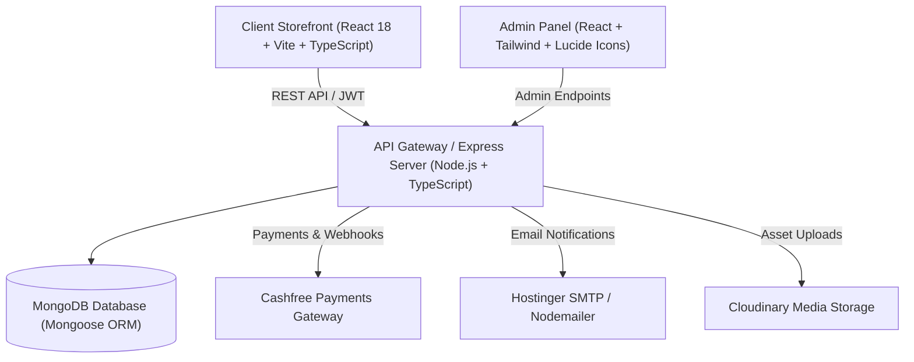

# 🌿 Matasree Super — Premium Spices E-Commerce Platform

[](https://nodejs.org/)
[](https://react.dev/)
[](https://www.typescriptlang.org/)
[](https://expressjs.com/)
[](https://www.mongodb.com/)
[](#)

**Matasree Super** is a modern, high-performance, full-stack e-commerce platform crafted for premium pure Indian spices. Built with an interactive and animated customer storefront, robust REST API backend, secure payment processing via Cashfree, automated inventory reservation, and a comprehensive admin management suite.

---

## 📑 Table of Contents

- [Architecture & Tech Stack](#-architecture--tech-stack)
- [Key Features](#-key-features)
  - [Customer Storefront](#customer-storefront)
  - [Backend & APIs](#backend--apis)
  - [Admin Suite](#admin-suite)
- [Project Structure](#-project-structure)
- [Getting Started](#-getting-started)
  - [Prerequisites](#prerequisites)
  - [1. Backend Setup](#1-backend-setup)
  - [2. Frontend Setup](#2-frontend-setup)
  - [3. Running with Docker](#3-running-with-docker)
- [Environment Variables](#-environment-variables)
- [Testing](#-testing)
- [API Overview](#-api-overview)
- [Contributing & License](#-contributing--license)

---

## 🏛 Architecture & Tech Stack



### Frontend (`matasree-superstore-main`)
- **Framework**: [React 18](https://react.dev/) with [Vite](https://vitejs.dev/) & [TypeScript](https://www.typescriptlang.org/)
- **UI & Styling**: [Tailwind CSS](https://tailwindcss.com/), [shadcn/ui](https://ui.shadcn.com/), Lucide Icons
- **Animations**: [Framer Motion](https://www.framer.com/motion/), custom canvas particle systems, interactive 3D jar showcases
- **State Management**: [Zustand](https://github.com/pmndrs/zustand)
- **Routing & Networking**: React Router 6, Axios with token refresh interceptors
- **SEO**: Structured JSON-LD metadata, OpenGraph tags, semantic HTML

### Backend (`matasree-backend`)
- **Runtime**: [Node.js](https://nodejs.org/) & [Express](https://expressjs.com/) with [TypeScript](https://www.typescriptlang.org/)
- **Database**: [MongoDB](https://www.mongodb.com/) via [Mongoose](https://mongoosejs.com/)
- **Security**: JWT (Access + Refresh tokens), bcryptjs, Helmet, CORS, Rate Limiting, Input Sanitization (Joi/Zod)
- **Payments**: Cashfree PG integration with secure signature verification and webhook processing
- **Email Service**: Hostinger SMTP with custom HTML templates for invoices and notifications
- **Jobs & Scheduling**: Automated stock reservation and timeout release cron jobs

---

## ✨ Key Features

### Customer Storefront
- **Immersive Spice Showcase**: Interactive spice explorer, heat meter gauge, spice dish matcher, and smooth parallax story scroll.
- **Product Catalog & Details**: Multi-weight variant selection (e.g. 50g, 100g, 250g, 500g), dynamic pricing, stock availability, and high-resolution galleries.
- **Cart & Fast Checkout**: Persistent cart, multi-address management, real-time coupon verification, and seamless Cashfree checkout.
- **Loyalty & Referral Program**: Earn points on purchases, redeem discounts, and invite friends with referral links.
- **Order Tracking**: Visual status timeline from placed to processing, dispatched, and delivered.
- **Product Reviews & Wishlists**: Verified purchase ratings, testimonials, and wishlist sync.

### Backend & APIs
- **Secure Authentication**: Email/Password and OAuth (Google & GitHub) with token rotation.
- **Payment Lifecycle**: Order token generation, webhook verification, and automated refund handling.
- **Inventory Safety**: Temporary stock locking during checkout with background expiration release.
- **Transactional Emails**: Automated order confirmation, dispatch updates, and PDF invoice generation.

### Admin Suite
- **Analytics & Reporting**: Sales revenue, recent orders, inventory alerts, and payment metrics.
- **Catalog Management**: Product CRUD, variant editor, SERP preview, bulk status actions, and category controls.
- **Order & User Management**: Process order fulfillment, manage customer loyalty balances, and review audit logs.
- **Marketing Tools**: Banner slider manager, discount coupons with expiry dates, and recipe library.

---

## 📁 Project Structure

```text
Matasree_Store/
├── matasree-backend/               # Express + TypeScript API Server
│   ├── src/
│   │   ├── config/                 # DB, Cloudinary, and environment configuration
│   │   ├── controllers/            # Request handlers (auth, orders, products, etc.)
│   │   ├── jobs/                   # Stock release and background workers
│   │   ├── middleware/             # Auth, error, rate limiter, image optimizer
│   │   ├── models/                 # Mongoose schemas (User, Product, Order, etc.)
│   │   ├── routes/                 # API endpoint declarations
│   │   ├── utils/                  # Cashfree, invoice generator, encryption
│   │   └── validators/             # Request payload validation schemas
│   ├── uploads/                    # Local asset uploads
│   └── package.json
│
├── matasree-superstore-main/       # React + Vite Frontend Application
│   ├── src/
│   │   ├── components/             # Reusable UI & animated components
│   │   │   ├── admin/              # Admin dashboard widgets & editors
│   │   │   ├── animation/          # Particle systems, cursors, magnetic buttons
│   │   │   ├── home/               # Hero, SpiceJar3D, Showcase sections
│   │   │   └── ui/                 # shadcn/ui components
│   │   ├── pages/                  # Route views (Home, Products, Checkout, Admin, etc.)
│   │   ├── services/               # Axios API clients
│   │   ├── store/                  # Zustand stores (auth, cart, wishlist, admin)
│   │   └── types/                  # Shared TypeScript interfaces
│   ├── public/                     # Static media & spice photography
│   └── package.json
│
├── docker-compose.yml              # Container setup for API, Frontend & Mongo
└── README.md                       # Project documentation
```

---

## 🚀 Getting Started

### Prerequisites
- [Node.js](https://nodejs.org/) (v18.x or v20.x recommended)
- [npm](https://www.npmjs.com/) or [pnpm](https://pnpm.io/)
- [MongoDB](https://www.mongodb.com/) (running locally or a MongoDB Atlas URI)

---

### 1. Backend Setup

```bash
cd matasree-backend

# Install dependencies
npm install

# Configure environment
cp .env.example .env
# Edit .env with your MongoDB URI, JWT secrets, Cashfree credentials, and SMTP configuration

# Run in development mode
npm run dev

# Build and run production server
npm run build
npm start
```
The API server will run at `http://localhost:5001`.

---

### 2. Frontend Setup

```bash
cd matasree-superstore-main

# Install dependencies
npm install

# Start development server
npm run dev
```
The client application will start at `http://localhost:8000` (or `http://localhost:5173`).

---

### 3. Running with Docker

Run the complete full-stack environment with Docker Compose:

```bash
docker compose up --build
```

---

## 🔐 Environment Variables

### Backend (`matasree-backend/.env`)
| Variable | Description | Default |
|---|---|---|
| `PORT` | API server port | `5001` |
| `MONGODB_URI` | MongoDB connection string | `mongodb://localhost:27017/matasree` |
| `FRONTEND_URL` | Allowed frontend CORS origin | `http://localhost:8000` |
| `JWT_SECRET` | Secret key for access tokens | - |
| `JWT_REFRESH_SECRET`| Secret key for refresh tokens | - |
| `CASHFREE_APP_ID` | Cashfree Payments Client ID | - |
| `CASHFREE_SECRET_KEY` | Cashfree Payments Secret Key | - |
| `CASHFREE_ENVIRONMENT` | Payment environment (`SANDBOX` or `PRODUCTION`) | `SANDBOX` |
| `SMTP_HOST` | Hostinger / SMTP server host | `smtp.hostinger.com` |
| `SMTP_PORT` | SMTP port | `465` |
| `SMTP_USER` | SMTP username / sender email | - |
| `SMTP_PASS` | SMTP password / app key | - |

*(Refer to [matasree-backend/.env.example](matasree-backend/.env.example) for the full list of options.)*

---

## 🧪 Testing

Both backend and frontend include automated test suites:

```bash
# Run backend tests
cd matasree-backend
npm test

# Run frontend tests
cd matasree-superstore-main
npm test
```

---

## 📡 API Overview

| Route Prefix | Purpose | Access |
|---|---|---|
| `/api/auth` | User registration, login, token refresh, OAuth | Public |
| `/api/products` | Browse spices, view product details, variants | Public |
| `/api/cart` | Add, update, and remove cart items | Customer |
| `/api/orders` | Create order, initialize Cashfree payment, track status | Customer |
| `/api/reviews` | Submit and view product ratings & reviews | Customer |
| `/api/loyalty` | View points balance, redeem discounts, referral link | Customer |
| `/api/admin` | Dashboard metrics, inventory management, bulk operations | Admin |
| `/api/webhooks` | Cashfree payment webhook receiver | Cashfree Gateway |

---

## 📄 License & Ownership

Copyright © 2026 **Matasree Super**. All rights reserved.  
Unauthorized copying, modification, or distribution is strictly prohibited.
